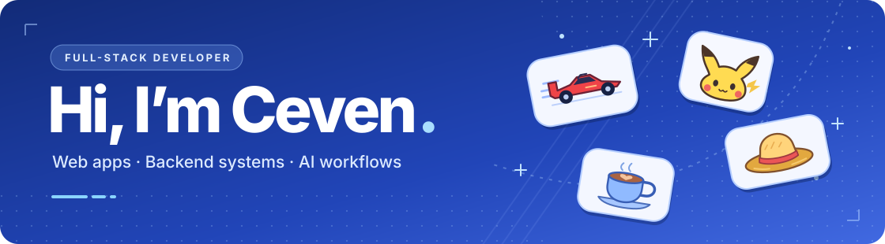

# Val Mykel Ceven Bolante

**Full-Stack Software Engineer**  
Web applications · Backend systems · AI-assisted development

Philippines · [LinkedIn](https://www.linkedin.com/in/valceven/) · [Email](mailto:valmykelcevenbolante@gmail.com)

I'm Ceven. I build web apps from the interface down to the database. I'm especially interested in how APIs, data access, and architecture choices make a system easier to maintain.

<picture>
  
</picture>

## Experience

### Hayahai

**Software Engineer** · Nov 2026–Present  
I build and maintain features across React and Next.js interfaces, NestJS APIs, and PostgreSQL. My work includes integrating APIs, improving queries with Prisma and Kysely, and refactoring existing code.

**Software Development Intern** · May 2025–Nov 2026  
I contributed to feature development, bug fixes, and testing across the application.

*Work is summarized at a high level to respect confidentiality and NDA obligations.*

## Selected projects

### Bitwise v2
**Interactive learning platform**

A collaborative platform for computer science learning, with lessons, assessments, progress tracking, and interactive logic tools. Built around a React interface and a NestJS API with relational data managed through Prisma.

React · TypeScript · NestJS · PostgreSQL · Prisma

[Frontend](https://github.com/One-Team-One-Goal/bitwise-ui) · [Backend](https://github.com/One-Team-One-Goal/bitwise-server)

### HumAI
**Rice quality analysis**

A collaborative research project connecting a Raspberry Pi imaging device, a Python inference API, and a React dashboard. My contributions span the device client, backend, and web interface.

React · TypeScript · Electron · Python · FastAPI · YOLO

[Dashboard](https://github.com/PhilRice-CITU/web-dashboard) · [API](https://github.com/PhilRice-CITU/api-server) · [Edge client](https://github.com/PhilRice-CITU/edge-client)

## Stack & workflow

| Area | Technologies |
| :--- | :--- |
| Frontend | React, Next.js, TypeScript, Tailwind CSS |
| Backend | Node.js, NestJS, REST APIs |
| Data | PostgreSQL, Prisma, Kysely |
| Development | Git, GitHub, Codex, Claude Code |

I use coding agents for focused implementation, refactoring, and debugging, supported by repository context, clear task boundaries, code review, and verification.

## Education

**Cebu Institute of Technology – University** · 2022–2026  
BS Computer Science

## Off the clock

Ferrari on race weekends, espresso between builds, and One Piece after hours. Pikachu gets a spot on the team.

<picture>
  
</picture>

**Open to remote engineering roles and freelance projects.**  
Interested in building and improving web applications, APIs, and internal tools.
